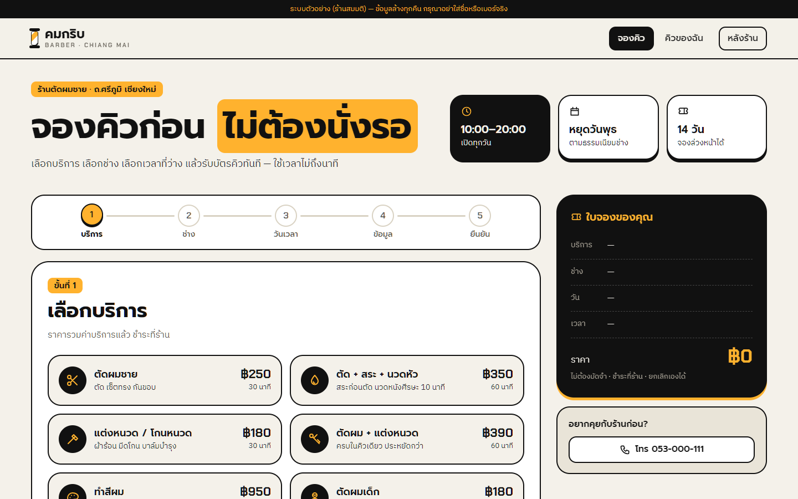
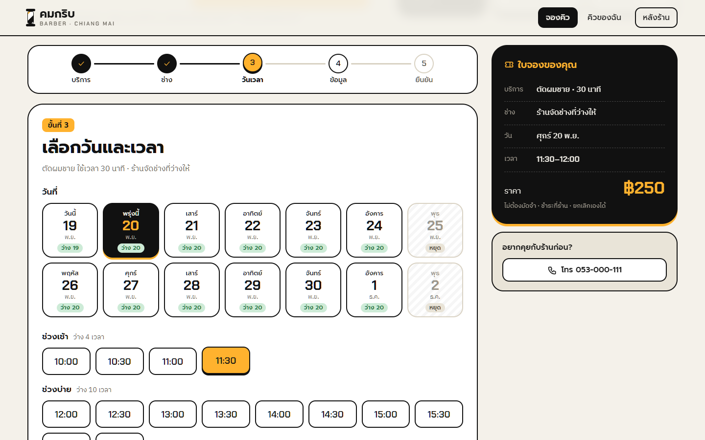
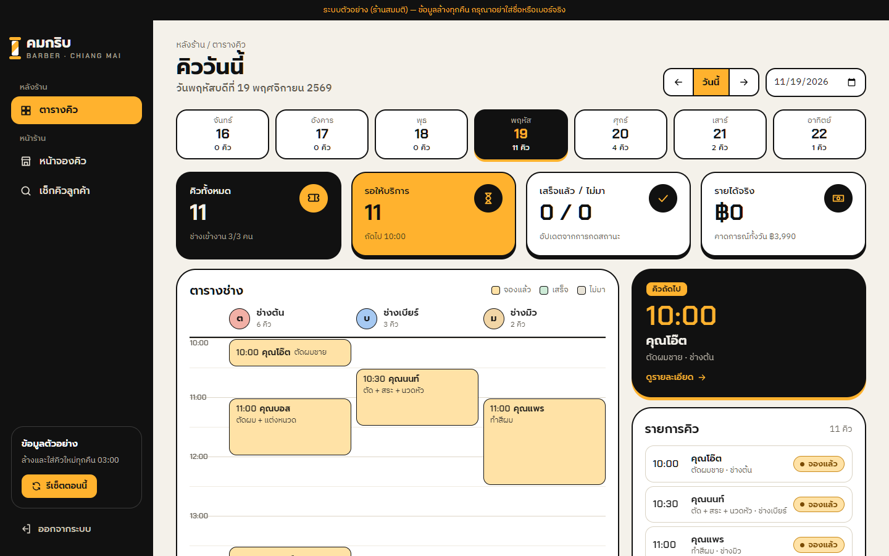

# คมกริบ บาร์เบอร์ — ระบบจองคิวร้านบริการ

ระบบจองคิวออนไลน์แบบใช้งานได้จริง ลูกค้าเลือกบริการ เลือกช่าง เลือกเวลาที่ว่าง แล้วรับ “บัตรคิว” ทันที ส่วนเจ้าของร้านมีหน้า **หลังร้าน** ไว้ดูตารางคิวของช่างแต่ละคนรายวัน

> ร้านนี้เป็นธุรกิจสมมติ ทำขึ้นเป็นผลงานตัวอย่าง ใช้ได้กับร้านตัดผม คลินิก สปา ร้านทำเล็บ ร้านนวด หรือร้านซ่อม

**ทดลองใช้:** https://komkrip.shswsy.workers.dev · หลังร้าน: `/admin` รหัสผ่าน `demo1234`
ข้อมูลตัวอย่างจะถูกล้างและใส่ใหม่ทุกคืนเวลา 03:00



## ฝั่งลูกค้า

- เลือกบริการ (ราคาและเวลาที่ใช้) และเลือกช่าง หรือเลือก “ช่างคนไหนก็ได้” ให้ระบบจัดช่างที่ว่างให้
- แถบวันล่วงหน้า 14 วัน บอกว่าแต่ละวันเหลือกี่คิว วันหยุดร้าน (พุธ) และวันหยุดของช่างแต่ละคนขึ้นให้เห็นเลย
- เวลาที่มีคนจองแล้วจะขีดฆ่า เวลาที่เลยไปแล้ววันนี้จะไม่แสดง (ต้องจองล่วงหน้าอย่างน้อย 30 นาที)
- ได้บัตรคิวพร้อมรหัส 6 ตัว บันทึกลงปฏิทินมือถือได้ (.ics พร้อมแจ้งเตือนก่อน 1 ชั่วโมง)
- หน้า “คิวของฉัน” ใช้รหัสคิวกับเบอร์โทรเพื่อเช็กหรือยกเลิกคิวเอง
- จองทีละขั้น 5 ขั้น (บริการ → ช่าง → วันเวลา → ข้อมูล → ยืนยัน) มีแถบบอกขั้นตอนด้านบน กดย้อนไปแก้ขั้นไหนก็ได้
- บนมือถือมีแถบสรุปติดด้านล่าง พร้อมปุ่ม “ถัดไป” และ “ยืนยันจอง” ปุ่มเวลาใหญ่กดง่าย



## ฝั่งร้าน (หลังร้าน)

- แดชบอร์ดมีเมนูด้านข้าง การ์ดสรุปตัวเลขของวัน การ์ดคิวถัดไป และรายการคิวพร้อมป้ายสถานะ
- ตารางคิวรายวันแยกคอลัมน์ตามช่าง มีเส้นบอกเวลาปัจจุบัน และไฮไลต์คิวที่กำลังให้บริการ
- กดคิวเพื่อดูรายละเอียด แล้วเปลี่ยนสถานะเป็น เสร็จแล้ว / ลูกค้าไม่มา / ยกเลิก
- สรุปจำนวนคิว รายได้จริง และรายได้ที่คาดการณ์ของวัน พร้อมคิวถัดไป
- ปิดรับจองเป็นรายวัน (เช่น หยุดสงกรานต์) ลูกค้าจะจองวันนั้นไม่ได้ทันที
- โหลดคิวใหม่อัตโนมัติทุก 30 วินาที



## ความถูกต้องและความปลอดภัย

- **กันจองชน:** การบันทึกคิวเป็นคำสั่ง SQL เดียวที่ตรวจว่าเวลานั้นยังว่างอยู่ในจังหวะที่เขียน ทดสอบยิงจองช่วงเวลาเดียวกันพร้อมกัน 6 คำขอ ได้คิวแค่ 1 คำขอ อีก 5 คำขอได้ข้อความ “คิวนี้เพิ่งถูกจองไป”
- คืนสถานะคิวที่ยกเลิกไปแล้วไม่ได้ ถ้ามีคนอื่นจองเวลานั้นไปแล้ว
- หลังร้านล็อกอินด้วย cookie แบบ HttpOnly ที่เซ็นด้วย HMAC และเทียบรหัสผ่านแบบ constant-time
- จำกัดความถี่ (rate limit) ของการจอง การค้นหาคิว และการล็อกอิน
- เบอร์หนึ่งเบอร์มีคิวที่ยังไม่ถึงเวลาได้ไม่เกิน 3 คิว
- ในเดโม เบอร์โทรที่หลังร้านจะถูกปิดบางส่วน และข้อมูลถูกล้างทุกคืน

## เทคโนโลยี

| ส่วน | ใช้ |
| --- | --- |
| หน้าเว็บ | React 19 + TypeScript + Vite |
| API | Cloudflare Workers + Hono |
| ฐานข้อมูล | Cloudflare D1 (SQLite) |
| งานตั้งเวลา | Cron Trigger (ล้างข้อมูลเดโมทุกคืน) |
| ทดสอบ | Vitest (ตัวคำนวณช่องเวลา) |

บริการ ช่าง เวลาเปิดปิด และวันหยุด อยู่ในไฟล์เดียว `shared/shop.ts` ซึ่งหน้าเว็บกับ API ใช้ร่วมกัน เปลี่ยนเป็นร้านอื่นได้โดยแก้ไฟล์นี้ไฟล์เดียว

## รันบนเครื่อง

```bash
npm install
cp .dev.vars.example .dev.vars      # ADMIN_PASSWORD, SESSION_SECRET
npm run db:migrate                  # สร้างตารางใน D1 บนเครื่อง
npm run dev                         # http://localhost:5173
npm test
```

## Deploy (Cloudflare)

```bash
npx wrangler login
npx wrangler d1 create komkrip      # นำ database_id ไปใส่ใน wrangler.jsonc
npm run db:migrate:remote
npx wrangler secret put ADMIN_PASSWORD
npx wrangler secret put SESSION_SECRET
npm run deploy
```

ถ้าเป็นร้านจริง ให้ตั้ง `"DEMO": "0"` ใน `wrangler.jsonc` เพื่อปิดการล้างข้อมูลทุกคืน และให้หลังร้านแสดงเบอร์โทรเต็ม
